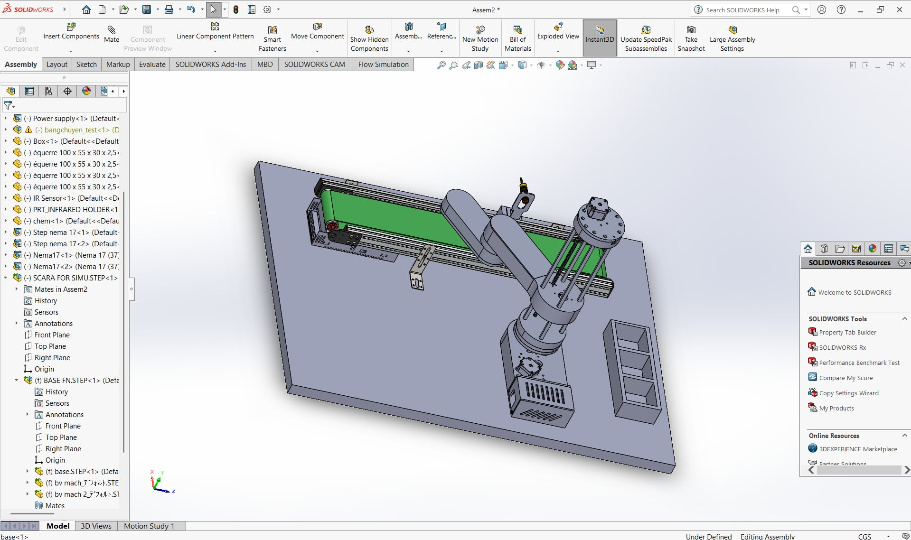

# SCARA Vision Sorting

A SCARA automation project with a camera-based inspection interface, Arduino motion firmware, and a MATLAB/Simulink model.

| Component | Entry point |
| --- | --- |
| Camera application with OpenCV ArUco and PyQt5 | [detecvat_fixed_font.py](SCARA/detecvat_fixed_font.py) |
| Arduino sketch | [FINAL-V3.ino](SCARA/FINAL-V3/FINAL-V3.ino) |
| Simulink model and MATLAB scripts | [SIMU](SCARA/SIMU) |
| Wiring diagram | [so_do_nguyen_li.png](so_do_nguyen_li.png) |

Install the Python dependencies with `python -m pip install -r requirements.txt`, then launch `python SCARA/detecvat_fixed_font.py`. Select and calibrate your camera in the application. Open the sketch and the Simulink model separately in their respective tools.
